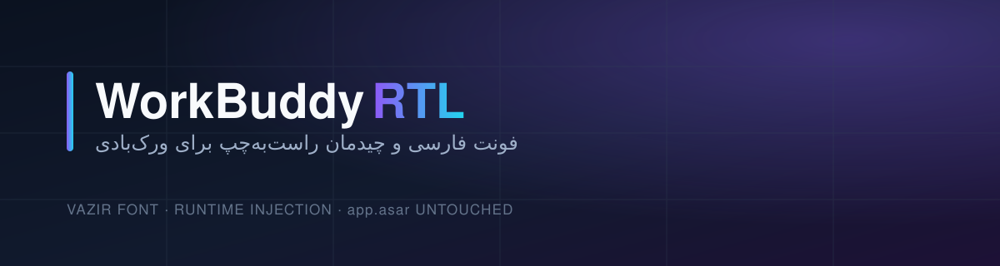

<p align="center">
  
</p>

<p align="center">
  <a href="https://github.com/MohammadMehdiSadeghi/work-buddy-rtl/releases"></a>
  <a href="LICENSE"></a>
  <a href="#quick-start"></a>
  <a href="package.json"></a>
  <a href="https://github.com/MohammadMehdiSadeghi/work-buddy-rtl/issues"></a>
</p>

<p align="center">
  <strong>WorkBuddy RTL</strong> makes the <strong>WorkBuddy</strong> desktop app comfortable in Persian:
  every Persian glyph is drawn with <strong>Vazir</strong>, every Persian message reads
  <strong>right-to-left</strong>, and the composer follows whatever you type — while the app's own
  files stay <strong>byte-for-byte untouched</strong>.
</p>

---

## 🌐 Table of Contents / فهرست مطالب
- [English Documentation](#-english-documentation)
  - [Overview](#overview)
  - [How It Works](#how-it-works)
  - [Key Features](#key-features)
  - [Quick Start](#quick-start)
  - [Commands](#commands)
  - [What Is Not Changed](#what-is-not-changed)
  - [Troubleshooting](#troubleshooting)
  - [Repository Layout](#repository-layout)
  - [Tests](#tests)
  - [Security Note](#security-note)
- [راهنمای فارسی](#-راهنمای-فارسی-persian-documentation)
  - [معرفی پروژه](#معرفی-پروژه)
  - [نحوه کارکرد](#نحوه-کارکرد)
  - [قابلیت‌های کلیدی](#قابلیت‌های-کلیدی)
  - [نصب و راه‌اندازی سریع](#نصب-و-راه‌اندازی-سریع)
  - [دستورها](#دستورها)
  - [چه چیزی تغییر نمی‌کند](#چه-چیزی-تغییر-نمی‌کند)
  - [رفع مشکل](#رفع-مشکل)
- [Author & License](#-author--license)

---

# 🇬🇧 English Documentation

## Overview

WorkBuddy ships an interface built for Latin and Chinese text: its font stacks
(`PingFang SC`, `Segoe UI`, `Microsoft YaHei`, `Inter`) contain no Arabic or
Persian glyphs, so Persian text falls back to a random system font, and the
chat layout is left-to-right, so a Persian sentence ends up ragged, with its
punctuation in the wrong place and English words jumping around inside it.

**WorkBuddy RTL** fixes both without modifying the application:

- **Persian font** — a Vazir variable face is attached to the families the app
  already asks for, restricted to the Arabic/Persian Unicode range. Latin, CJK
  and the monospace stack keep their own fonts.
- **Direction** — the composer takes its direction from the first strong
  character you type, and every message, label or paragraph that starts with a
  Persian letter is marked `dir="rtl"` and right-aligned.
- **Code stays LTR** — code blocks, inline code, terminals, diffs and editors
  are isolated left-to-right, so a snippet inside a Persian answer is never
  reordered.

The app is started through a small launcher that injects the layer at runtime
over the Chrome DevTools Protocol. That is not a stylistic choice: WorkBuddy is
built with Electron's **ASAR integrity validation**, so editing `app.asar`
makes the app abort at startup with `FATAL: Integrity check failed for asar
archive`. See [`docs/TECHNICAL.md`](docs/TECHNICAL.md) for the whole story.

## How It Works

```
WorkBuddy RTL shortcut / node tools/launch.mjs
        │
        ├─ finds the install and WorkBuddyAI.exe        (tools/locate.mjs)
        ├─ starts the app with a loopback DevTools port  (127.0.0.1, random high port)
        ├─ waits for the renderer target                 (app.asar/renderer/index.html)
        └─ injects, per window:
             • patch/workbuddy-rtl.css  — Vazir @font-face + direction rules
             • patch/workbuddy-rtl.js   — direction detection
           and keeps watching, so every new window and every reload gets it too
```

`app.asar` is never opened for writing. Nothing is copied into the install
folder, so an application update cannot remove the layer — only the launcher
process has to be restarted to pick up a new version.

## Key Features

- 🔤 **Vazir everywhere Persian appears** — bundled variable font (no download,
  works offline), all weights, only for the Arabic/Persian codepoints.
- ↔️ **Automatic direction** — a Persian prompt types right-to-left, an English
  one stays left-to-right, no toggle to remember.
- 🧠 **Per-paragraph bidi** — `unicode-bidi: plaintext` keeps mixed
  English/Persian sentences in the right order.
- 💻 **Code is never flipped** — code blocks, inline code, terminals, diffs and
  the editor stay left-to-right.
- 🎨 **Theme-safe** — the layer sets font, direction and alignment only; it
  never overrides a colour, so light and dark themes both look right.
- 🪶 **Nothing is patched** — `app.asar` stays byte-for-byte identical, so the
  integrity check, the updater and the code signature all keep working.
- 🪟 **Every window** — the main window, settings, extra conversations and any
  window opened later are injected as they appear.
- 🧪 **Checked, not hoped** — `tools/verify.mjs`, a jsdom behaviour test and a
  headless-Chromium end-to-end test ship with the repo.

## Quick Start

**Requires:** [Node.js 22+](https://nodejs.org) (the launcher uses the built-in
`fetch` and `WebSocket`). WorkBuddy must be closed before the launcher starts —
the app takes a single-instance lock, so a second copy would exit immediately.

### Windows (recommended)

```powershell
git clone https://github.com/MohammadMehdiSadeghi/work-buddy-rtl.git
cd work-buddy-rtl

# create the "WorkBuddy RTL" desktop + Start-menu shortcut
.\windows\install-shortcut.ps1
```

From now on start WorkBuddy from that shortcut. It runs the launcher hidden,
injects the layer and closes itself when the app exits.

If PowerShell refuses to run the script, use it once in the same window:

```powershell
Set-ExecutionPolicy -Scope Process -ExecutionPolicy Bypass
```

### Any platform

```bash
git clone https://github.com/MohammadMehdiSadeghi/work-buddy-rtl.git
cd work-buddy-rtl

node tools/locate.mjs      # find the install and its version
node tools/launch.mjs      # start WorkBuddy with the layer
```

The launcher is plain Node with no dependencies; `--root "<install folder>"`
points it at a non-standard install. The shortcut scripts are Windows-only —
on macOS and Linux use the launcher directly (or point a desktop entry at it).

## Commands

| Command | What it does |
| --- | --- |
| `node tools/launch.mjs` | start WorkBuddy with the layer injected |
| `node tools/launch.mjs --status` | report install, version, running state and patch health — **never** starts anything |
| `node tools/launch.mjs --check` | same report, exit code `1` when the patch is broken |
| `node tools/launch.mjs --restart` | close a running instance, then start with the layer |
| `node tools/launch.mjs --root <dir>` | use an install that is not in a standard location |
| `node tools/launch.mjs --port <n>` | pin the DevTools port instead of a random one |
| `node tools/launch.mjs --quiet` | no output (used by the hidden shortcut) |
| `node tools/launch.mjs -- --user-data-dir=…` | pass extra switches to the app |
| `node tools/locate.mjs [--json]` | list WorkBuddy installs found on this machine |
| `node tools/verify.mjs` | run every static check on the patch and the tools |

Or through the PowerShell wrapper:

```powershell
.\windows\launch-windows.ps1            # launch
.\windows\launch-windows.ps1 -Status    # report
.\windows\launch-windows.ps1 -Check     # verify
.\windows\launch-windows.ps1 -Restart   # restart with the layer
```

## What Is Not Changed

- **`app.asar` and every other app file** — not opened for writing, not
  rewritten, not re-signed.
- **Latin, Cyrillic and CJK text** — keeps the app's own font; only the
  Arabic/Persian range is redirected to Vazir.
- **Monospace, icons and the terminal** — untouched, and forced left-to-right.
- **Layout, sizes and spacing** — the layer does not change any dimension.
- **Colours and theme** — no background, border or text colour is set, so the
  light and the dark theme both look correct.
- **The app's interface language** — the layer does not translate strings; it
  makes the interface *render* Persian correctly.

## Troubleshooting

| Symptom | Cause | Fix |
| --- | --- | --- |
| `WorkBuddy is already running` | the app takes a single-instance lock, so a second copy exits | close WorkBuddy (tray included) and launch again, or use `--restart` |
| Nothing is Persian | the app was started from its own `.exe`, not from the shortcut | start it through the shortcut or `node tools/launch.mjs` |
| Layer disappears after a while | the launcher process was closed | keep it running; it exits by itself when WorkBuddy closes |
| Part of the UI stays left-aligned | that part lives in a webview/iframe or a shadow root, which page CSS cannot reach | open an issue naming the section |
| Fonts look too large/small | the layer does not change sizes | adjust WorkBuddy's own appearance settings |
| A snippet inside a Persian answer is right-aligned | it is not inside a recognised code container | open an issue with the block's HTML |
| `--status` shows `Launcher: not active` | the app is running without the layer | restart it through the shortcut |

## Repository Layout

| Path | Purpose |
| --- | --- |
| `patch/workbuddy-rtl.css` | Vazir `@font-face` for the app's font families + direction and alignment rules |
| `patch/workbuddy-rtl.js` | direction detection for the composer, messages, labels and lists |
| `patch/fonts/` | Vazir variable `woff2` + OFL license |
| `tools/launch.mjs` | find the app, start it with a DevTools port, inject, watch new windows |
| `tools/inject.mjs` | CDP plumbing: payload building, target discovery, injection |
| `tools/locate.mjs` | find WorkBuddy installs (Windows, macOS, Linux) |
| `tools/asar.mjs` | dependency-free, read-only `app.asar` reader |
| `tools/verify.mjs` | static checks: patch files, syntax, font, tools, install |
| `tests/direction.test.mjs` | the direction script against a jsdom fixture |
| `tests/browser.test.mjs` | the full CDP path in headless Chrome/Edge |
| `windows/launch-windows.ps1` | PowerShell wrapper (`-Status`, `-Check`, `-Restart`) |
| `windows/install-shortcut.ps1` | desktop / Start-menu shortcut |
| `assets/workbuddy-rtl-banner.svg` | the banner above |
| `docs/TECHNICAL.md` | design and implementation notes |

## Tests

```bash
node tools/verify.mjs            # static checks, no dependencies
npm install                      # only for the two tests below (jsdom)
node tests/direction.test.mjs    # direction behaviour in a DOM
node tests/browser.test.mjs      # end-to-end injection in headless Chrome/Edge
```

`tests/browser.test.mjs` uses the same `tools/inject.mjs` calls as the
launcher, so a green run means the injection path really works in a Chromium
renderer — including the reload case. It skips itself when no Chrome or Edge is
installed.

## Security Note

While WorkBuddy runs through this launcher, a DevTools endpoint listens on
`127.0.0.1` on a random high port. That port is how the layer is injected: it
is bound to loopback only, it accepts no connections from the network, and it
disappears when the app closes. The launcher writes one small state file
(`%TEMP%/workbuddy-rtl.json`, holding its pid and port) so `--status` can tell
whether the running app is a launched one; it is removed on exit. Launching
WorkBuddy without the launcher gives a plain app with no port and no layer.

---

# 🇮🇷 راهنمای فارسی (Persian Documentation)

<div dir="rtl" align="right">

## معرفی پروژه

رابط کاربری **WorkBuddy** برای متن لاتین و چینی طراحی شده است: فونت‌هایی که
برنامه استفاده می‌کند (`PingFang SC`، `Segoe UI`، `Microsoft YaHei`، `Inter`)
هیچ گلیف فارسی ندارند، بنابراین متن فارسی با یک فونت سیستمی تصادفی نمایش داده
می‌شود؛ چیدمان گفتگو هم چپ‌به‌راست است و در نتیجه جمله فارسی ناهم‌تراز می‌شود،
علامت‌گذاری‌اش جابه‌جا می‌افتد و کلمه انگلیسیِ وسط جمله فارسی می‌پرد.

**WorkBuddy RTL** هر دو مشکل را بدون دست‌زدن به فایل‌های برنامه حل می‌کند:

- **فونت فارسی**: فونت متغیر وزیر به همان خانواده‌هایی وصل می‌شود که برنامه
  از قبل درخواست می‌کند، اما فقط برای محدوده یونیکد عربی/فارسی. متن لاتین، چینی
  و فونت کد دست‌نخورده می‌ماند.
- **جهت متن**: جهت کادر نوشتن از اولین حرف قویِ تایپ‌شده تعیین می‌شود و هر
  پیام، برچسب یا پاراگرافی که با حرف فارسی شروع شود `dir="rtl"` می‌گیرد و
  راست‌چین می‌شود.
- **کد همیشه چپ‌به‌راست است**: بلوک کد، کد درون‌خطی، ترمینال، دیف و ویرایشگر
  ایزوله و چپ‌به‌راست می‌مانند تا قطعه‌کد داخل یک پاسخ فارسی به‌هم نریزد.

برنامه از طریق یک لانچر کوچک اجرا می‌شود که لایه را در زمان اجرا و با پروتکل
Chrome DevTools تزریق می‌کند. این انتخاب سلیقه‌ای نیست: WorkBuddy با قابلیت
**اعتبارسنجی یکپارچگی ASAR** الکترون ساخته شده و هر تغییری در `app.asar` باعث
می‌شود برنامه هنگام اجرا با خطای `FATAL: Integrity check failed for asar
archive` بسته شود. جزئیات کامل در [`docs/TECHNICAL.md`](docs/TECHNICAL.md).

## نحوه کارکرد

```
میان‌بر WorkBuddy RTL یا node tools/launch.mjs
        │
        ├─ مسیر نصب و WorkBuddyAI.exe را پیدا می‌کند      (tools/locate.mjs)
        ├─ برنامه را با پورت دیباگ محلی اجرا می‌کند        (127.0.0.1، پورت تصادفی)
        ├─ منتظر پنجره رندرر می‌ماند                        (app.asar/renderer/index.html)
        └─ در هر پنجره تزریق می‌کند:
             • patch/workbuddy-rtl.css  — فونت وزیر + قواعد جهت
             • patch/workbuddy-rtl.js   — تشخیص خودکار جهت متن
           و همچنان نگهبان می‌ماند تا پنجره‌های جدید و بارگذاری مجدد هم پوشش داده شوند
```

فایل `app.asar` هرگز برای نوشتن باز نمی‌شود و هیچ فایلی داخل پوشه نصب کپی
نمی‌شود؛ پس به‌روزرسانی برنامه لایه را پاک نمی‌کند و فقط باید لانچر را دوباره
اجرا کنید تا نسخه جدید را بخواند.

## قابلیت‌های کلیدی

- 🔤 **وزیر برای هر متن فارسی**: فونت متغیر همراه پروژه است (بدون دانلود،
  آفلاین)، همه وزن‌ها، فقط برای بازه عربی/فارسی.
- ↔️ **جهت خودکار**: پرامپت فارسی راست‌به‌چپ تایپ می‌شود و پرامپت انگلیسی
  چپ‌به‌راست؛ هیچ کلیدی برای جابه‌جایی لازم نیست.
- 🧠 **جهت‌دهی پاراگراف‌به‌پاراگراف**: با `unicode-bidi: plaintext` جمله‌های
  ترکیبی فارسی/انگلیسی درست خوانده می‌شوند.
- 💻 **کد هرگز برنمی‌گردد**: بلوک کد، کد درون‌خطی، ترمینال، دیف و ویرایشگر
  چپ‌به‌راست می‌مانند.
- 🎨 **سازگار با هر تم**: لایه فقط فونت، جهت و تراز را تعیین می‌کند و هیچ
  رنگی را بازنویسی نمی‌کند؛ تم روشن و تاریک هر دو درست دیده می‌شوند.
- 🪶 **هیچ فایلی وصله نمی‌شود**: `app.asar` بایت‌به‌بایت دست‌نخورده می‌ماند، پس
  بررسی یکپارچگی، به‌روزرسان و امضای کد همه سالم می‌مانند.
- 🪟 **همه پنجره‌ها**: پنجره اصلی، تنظیمات، گفتگوهای دیگر و هر پنجره‌ای که بعداً
  باز شود، هنگام ظاهر شدن تزریق می‌شوند.
- 🧪 **آزموده‌شده**: اسکریپت `tools/verify.mjs`، تست رفتار DOM و تست سرتاسری در
  Chromium همراه مخزن هستند.

## نصب و راه‌اندازی سریع

**پیش‌نیاز:** [Node.js 22+](https://nodejs.org). برنامه WorkBuddy باید بسته باشد؛
برنامه قفل تک‌نمونه‌ای دارد و نسخه دوم بلافاصله بسته می‌شود.

### ویندوز (پیشنهادی)

```powershell
git clone https://github.com/MohammadMehdiSadeghi/work-buddy-rtl.git
cd work-buddy-rtl

# ساخت میان‌بر «WorkBuddy RTL» روی دسکتاپ و منوی شروع
.\windows\install-shortcut.ps1
```

از این پس WorkBuddy را با همان میان‌بر باز کنید. میان‌بر لانچر را مخفی اجرا
می‌کند، لایه را تزریق می‌کند و با بسته‌شدن برنامه خودش تمام می‌شود.

اگر PowerShell اجازه اجرا نداد، یک‌بار در همان پنجره اجرا کنید:

```powershell
Set-ExecutionPolicy -Scope Process -ExecutionPolicy Bypass
```

### هر سیستم‌عاملی

```bash
node tools/locate.mjs      # پیدا کردن مسیر نصب و نسخه
node tools/launch.mjs      # اجرای WorkBuddy همراه با لایه
```

لانچر Node خالص و بدون وابستگی است؛ با `--root "<مسیر نصب>"` می‌توانید مسیر
غیراستاندارد بدهید. اسکریپت‌های میان‌بر فقط برای ویندوز هستند — در macOS و
لینوکس خود لانچر را اجرا کنید.

## دستورها

| دستور | کار |
| --- | --- |
| `node tools/launch.mjs` | اجرای WorkBuddy همراه با تزریق لایه |
| `node tools/launch.mjs --status` | گزارش مسیر نصب، نسخه، وضعیت اجرا و سلامت پچ — **برنامه را اجرا نمی‌کند** |
| `node tools/launch.mjs --check` | همان گزارش، با کد خروج `1` اگر پچ ناقص باشد |
| `node tools/launch.mjs --restart` | بستن نسخه در حال اجرا و سپس اجرای دوباره با لایه |
| `node tools/launch.mjs --root <dir>` | مسیر نصب غیراستاندارد |
| `node tools/launch.mjs --port <n>` | تعیین پورت ثابت به‌جای پورت تصادفی |
| `node tools/launch.mjs --quiet` | بدون خروجی (برای میان‌بر مخفی) |
| `node tools/launch.mjs -- --user-data-dir=…` | ارسال سوییچ‌های اضافه به خود برنامه |
| `node tools/locate.mjs [--json]` | فهرست نسخه‌های نصب‌شده روی این سیستم |
| `node tools/verify.mjs` | اجرای همه بررسی‌های ایستا روی پچ و ابزارها |

## چه چیزی تغییر نمی‌کند

- **`app.asar` و بقیه فایل‌های برنامه** — نه بازنویسی می‌شوند، نه دوباره امضا.
- **متن لاتین، سیریلیک و چینی** — فونت خود برنامه را نگه می‌دارد.
- **فونت کد، آیکون‌ها و ترمینال** — دست‌نخورده و چپ‌به‌راست.
- **چیدمان، اندازه‌ها و فاصله‌ها** — هیچ اندازه‌ای تغییر نمی‌کند.
- **رنگ‌ها و تم** — هیچ رنگ پس‌زمینه، حاشیه یا متنی تعیین نمی‌شود.
- **زبان رابط کاربری** — لایه رشته‌ها را ترجمه نمی‌کند؛ فقط نمایش فارسی را
  درست می‌کند.

## رفع مشکل

| نشانه | علت | راه‌حل |
| --- | --- | --- |
| `WorkBuddy is already running` | قفل تک‌نمونه‌ای برنامه | برنامه را کامل ببندید (سینی سیستم هم) و دوباره اجرا کنید، یا `--restart` بزنید |
| هیچ چیز فارسی نیست | برنامه از `.exe` خودش اجرا شده، نه از میان‌بر | با میان‌بر یا `node tools/launch.mjs` اجرا کنید |
| لایه بعد از مدتی از بین می‌رود | فرایند لانچر بسته شده | لانچر را باز بگذارید؛ خودش با بسته‌شدن WorkBuddy تمام می‌شود |
| بخشی از رابط هنوز چپ‌چین است | آن بخش داخل webview/iframe یا shadow root است | با ذکر نام آن بخش issue باز کنید |
| فونت خیلی بزرگ یا کوچک است | لایه اندازه‌ها را تغییر نمی‌دهد | از تنظیمات ظاهری خود WorkBuddy تنظیم کنید |
| `Launcher: not active` در `--status` | برنامه بدون لایه در حال اجراست | با میان‌بر دوباره اجرا کنید |

</div>

---

## 👨‍💻 Author & License

Developed with ❤️ by **[Mohammad Mehdi Sadeghi](https://github.com/MohammadMehdiSadeghi)**

- 🌐 GitHub: [@MohammadMehdiSadeghi](https://github.com/MohammadMehdiSadeghi)
- 💼 LinkedIn: [mohammad-mehdi-sadeghi](https://www.linkedin.com/in/mohammad-mehdi-sadeghi)

Scripts and patch are licensed under the **MIT License** — see the [LICENSE](LICENSE) file.
The bundled Vazir font is under the **SIL Open Font License 1.1** — see
[`patch/fonts/LICENSE-Vazir.txt`](patch/fonts/LICENSE-Vazir.txt).
